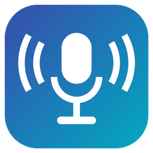

#  Voice Without Borders

Share a microphone and system sound between two Windows PCs on the same network. Think *Mouse Without Borders*, but for audio: plug one headset into one computer and use it for both.

Each computer can **send** its microphone and/or whatever it is playing, and **play** what the other one sends on any output device.

## Typical setup: one headset, two computers

Headset is plugged into **Desk PC**. You also want to talk and listen on **Laptop**.

| | Desk PC (headset here) | Laptop |
|---|---|---|
| My microphone | Headset mic | Off |
| Sound playing on | Off | Speakers (the device apps play to) |
| Its microphone becomes | Off | **CABLE Output** (virtual microphone) |
| Play its sound on | Headset | Off |

On the laptop, apps (Teams, Discord, Zoom…) then use **CABLE Output** as their microphone: it carries the desk PC's headset mic. In Windows sound settings, make **CABLE Output** both the *default* and the *default communications* recording device, so apps that just use "default" pick it too.

The laptop's own microphone is not mixed in: Windows never combines microphones, and each app records from exactly one input. Only the headset mic reaches the call, even if you sit right next to the laptop.

### Why a virtual cable?

An app cannot push audio into a microphone: Windows only lets drivers create microphones. A free virtual audio cable such as [VB-CABLE](https://vb-audio.com/Cable/) adds a pair of devices: whatever is played into **CABLE Input** comes out of the microphone **CABLE Output**.

*Its microphone becomes* lists only such virtual microphones, by the name apps show. The app plays the incoming mic into the matching playback side for you, so a real microphone or speakers cannot be picked by mistake.

VB-CABLE is not bundled (its license does not allow redistribution); install it from the link above or in the app.

The same applies to a computer with no sound card at all (a server, a VM): it has nothing to play on until a virtual cable is installed. The app shows a warning when it finds no playback devices.

### Avoid feedback loops

- Do not send the sound of a device you also play the incoming sound on: it would be sent straight back.
- Do not play the incoming mic on your speakers while sending their sound.

## Getting started

1. Install the [.NET 10 Desktop Runtime](https://dotnet.microsoft.com/download/dotnet/10.0) on both PCs (or build from source, see below).
2. Run `VoiceWithoutBorders.exe` on both PCs.
3. On each PC enter the **other** computer's name or IP address and the same **UDP port** (default `15300`). The first PC generates a random **shared key**: type that same key on the other PC (or press **New** for a fresh one).
4. Choose the devices, then press **Start** on both.
5. Allow the app through Windows Firewall when asked. The prompt only allows **private** networks by default: if Windows marks your network as *Public* (Settings → Network & internet → your connection → Network profile type), switch it to *Private*, or incoming audio is blocked.

The status line shows the address the name resolved to, plus packets sent, received and rejected. Lots of rejected packets and nothing received usually means the shared keys differ. If the address is wrong (a computer name resolving to a VPN or virtual adapter), enter the IP address instead of the name.

**Max latency** caps the jitter buffer. Lower values feel snappier; raise it if you hear crackles on Wi‑Fi.

## While streaming

- **Tray:** minimizing hides the window to the notification area. Double-click the icon to bring it back; right-click for Start/Stop, the toggles below, and Exit.
- **Overlay:** a small pill at the top of the screen shows each active stream (↑ sent, ↓ received) with bars that follow the audio level. It is click-through and never takes focus. Turn it off under *While streaming* or in the tray menu.
- **Hotkeys** (work from any app): **Ctrl+Alt+M** turns the microphone stream on/off, **Ctrl+Alt+S** the sound stream. A stream that is off is neither sent nor played on this computer; the overlay shows it crossed out.

## How it works

- Audio is captured with WASAPI (loopback capture for system sound) and converted by Windows to 48 kHz, 16-bit stereo PCM.
- 5 ms chunks are sent over UDP. Lost packets are skipped rather than retransmitted.
- The receiver buffers up to *max latency* and plays on the chosen device. When clock drift fills the buffer it skips ahead.
- Bandwidth is about 1.6 Mbit/s per active stream (uncompressed).

## Security

- Every packet is encrypted and authenticated with **AES-256-GCM**. The key is derived from the shared key with PBKDF2-SHA256 (210,000 iterations).
- Packets that fail authentication, duplicates, late packets and reflected copies of your own packets are dropped.
- The shared key is stored encrypted with Windows DPAPI under your user account (`%AppData%\VoiceWithoutBorders\settings.json`).
- There is no discovery or handshake. Only packets made with the shared key are played.
- Known limitation: someone on your network who records traffic could replay an *earlier* session's audio to you. Use a strong key and keep the port off the internet.
- Designed for a trusted LAN. Do not forward the port through your router.

## Building from source

Requires the [.NET 10 SDK](https://dotnet.microsoft.com/download) on Windows.

```powershell
dotnet build VoiceWithoutBorders.slnx
dotnet test VoiceWithoutBorders.slnx
dotnet run --project VoiceWithoutBorders
```

## Limitations and ideas

- Two computers only; no automatic discovery (enter the name or IP).
- Uncompressed audio. Opus would cut bandwidth by about 20x.
- Unplugging a device while streaming needs a Stop/Start.
- Hotkeys are fixed (Ctrl+Alt+M / Ctrl+Alt+S); no auto-start with Windows yet.

## Tech stack

.NET 10 · WPF (Fluent theme) · [NAudio](https://github.com/naudio/NAudio) · CommunityToolkit.Mvvm · Microsoft.Extensions.Hosting · xUnit, FluentAssertions, Moq
