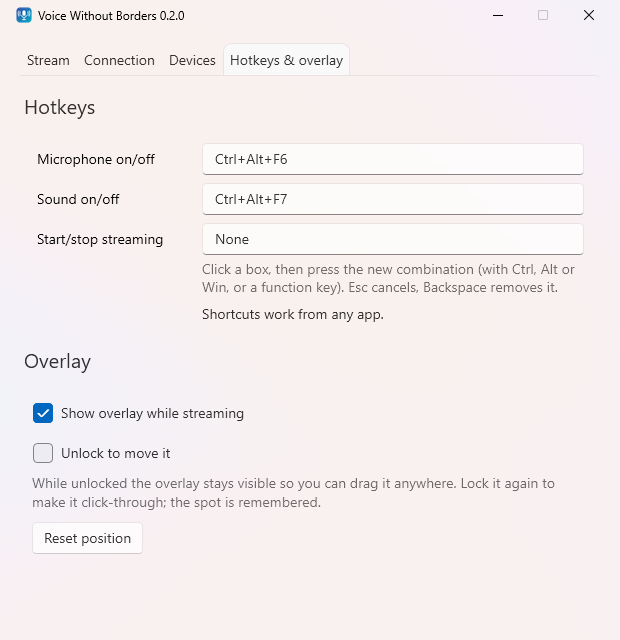

# FAQ and troubleshooting

New here? Start with the [install guide](install.md).

## Connection

### It stays on **● Waiting** (amber)

Nothing has arrived from the other computer yet. Check, in order:

1. The app is running on the other computer and **Start** is pressed there.
2. Both computers use the same **port** and the same **shared key**.
3. The *Stream* tab shows the address the name resolved to. If it's wrong (a VPN or virtual adapter, for example), enter the IP address instead of the name. You can find it with `ipconfig` on the other computer.
4. Windows Firewall: the network must be **Private**, not *Public* (Settings → Network & internet → your connection). If you dismissed the firewall prompt, allow the app in *Windows Security → Firewall & network protection → Allow an app through firewall*.
5. Both computers are on the same network. Guest Wi-Fi often isolates devices from each other.

### It says **● Different key** (red)

Packets arrive but fail authentication. Either the shared keys differ (retype the key on one computer; it is case-sensitive), or the two computers run different app versions with incompatible packet formats. Update both.

### Can I use it over the internet?

No, and don't forward the port on your router. The app is built for a trusted LAN. A VPN that puts both PCs on one network (Tailscale, WireGuard) works: enter the other computer's VPN address.

### More than two computers?

Not supported. Each session has exactly one other computer.

## Audio

### Apps on the other computer don't hear my mic

- That computer needs a virtual cable ([install guide, step 3](install.md#3-install-a-virtual-cable-only-where-the-other-pcs-mic-should-become-a-microphone)), with **CABLE Output** chosen under *Its microphone becomes*.
- In the app (Teams, Discord, Zoom…), set the microphone to **CABLE Output**, or make it the Windows default.
- Check that the mic stream isn't toggled off: **Ctrl+Alt+M**, the tray menu, or the crossed-out arrow in the overlay.

### *Its microphone becomes* is empty

No virtual microphone is installed. Install VB-CABLE, then press **Refresh devices**. Real microphones are deliberately not listed there.

### I hear echo or my own voice

That's a feedback loop: audio being sent back to where it came from. Don't send the sound of a device you also play incoming sound on, and don't play the incoming mic on speakers whose sound you are sending. See [Avoid feedback loops](../README.md#avoid-feedback-loops).

### Crackles, dropouts, or "Audio is being skipped to catch up"

The network is uneven, usually Wi-Fi. Raise *Max latency* on the Connection tab (try 300 to 400 ms), or connect one or both PCs by cable.

### Latency is high

The *Stream* tab breaks the delay down. The jitter buffer (*Max latency*) is the part you control: lower it for snappier audio until crackles appear. Wired connections allow much lower values than Wi-Fi.

### I unplugged or switched a headset and the sound stopped

Press **Stop** then **Start**, so the app reopens the devices.

### Does the laptop's own mic get mixed in?

No. Apps record from a single microphone, so only the one you pick (for example **CABLE Output**) reaches the call.

### How much bandwidth does it use?

About 1.6 Mbit/s per active stream, since audio is sent uncompressed.

## Everyday use

### Where did the window go?

Minimizing sends it to the tray (notification area). Double-click the icon to bring it back. Launching the app again also brings up the running one.

### Does it survive sleep or hibernation?

Yes. Once both computers are awake and the other one answers, streaming resumes on its own.

### A hotkey doesn't work

Another app may already use that combination. The *Hotkeys & overlay* tab tells you when this happens. Pick a different one.

### How do I move the overlay?

Tick *Unlock to move it*, drag the overlay, then untick. *Reset position* puts it back at the top centre.

## Security and privacy

### Is my audio encrypted?

Yes. Every packet uses AES-256-GCM with a key derived from your shared key. Packets that fail authentication are dropped. For the details and the known limits, see [Security](../README.md#security).

### Where are my settings?

They are in `%AppData%\VoiceWithoutBorders\settings.json`. The shared key in that file is encrypted with Windows DPAPI for your user account.

### Why is it not code-signed?

Individual signing certificates publish the signer's full legal name. Every release lists SHA-256 checksums instead, and the in-app updater refuses any installer that doesn't match its checksum.
