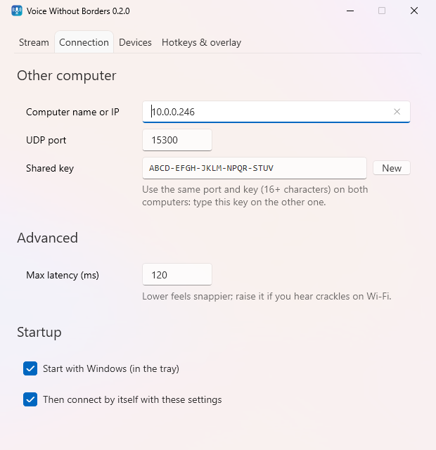
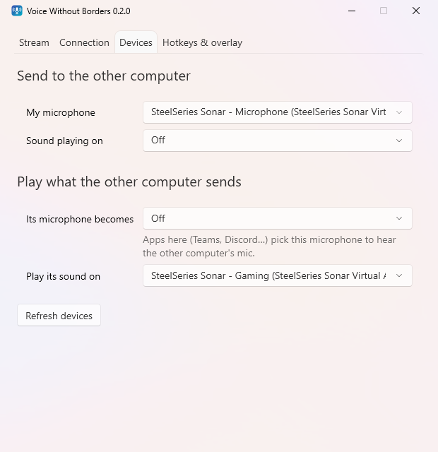
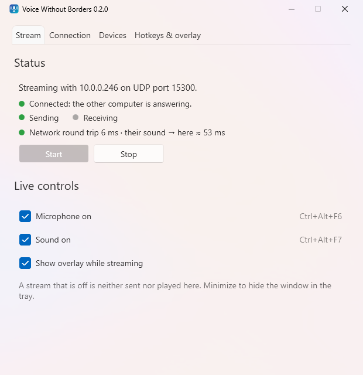

# Install guide

Do these steps on **both** computers. You need 64-bit Windows 10 or 11 and the two PCs on the same network. You don't need .NET or admin rights.

## 1. Download

From the [latest release](https://github.com/Lunat1q/VoiceWithoutBorders/releases/latest), take one of:

| File | When |
|------|------|
| `VoiceWithoutBorders-Setup-<version>.exe` | Recommended. Installs for your account only, into `%LOCALAPPDATA%\Programs\VoiceWithoutBorders`, with a Start menu entry. |
| `VoiceWithoutBorders-<version>-win-x64.zip` | Portable. Unzip anywhere and run `VoiceWithoutBorders.exe`. |

Both contain the same program. The release page lists the SHA-256 of each file if you want to check the download:

```powershell
Get-FileHash .\VoiceWithoutBorders-Setup-<version>.exe
```

## 2. Get past SmartScreen

Releases are not code-signed, so the first run may show **"Windows protected your PC"**. Click **More info → Run anyway**. Windows remembers your choice for that file.

## 3. Install a virtual cable (only where the other PC's mic should become a microphone)

Windows only lets drivers create microphones, so to use the other computer's mic in Teams, Discord, Zoom and so on, that computer needs a virtual audio cable. Install the free [VB-CABLE](https://vb-audio.com/Cable/) (run its setup as administrator, then reboot). This adds **CABLE Input** (a playback device) and **CABLE Output** (a microphone).

In the typical one-headset setup, you install it on the computer *without* the headset. The computer with the headset doesn't need it.

Then, in Windows sound settings (Settings → System → Sound → More sound settings → Recording), right-click **CABLE Output** and choose both **Set as Default Device** and **Set as Default Communication Device**. Apps that just use the default microphone will then pick it up too.

## 4. Configure

Open Voice Without Borders on both computers.



1. **Connection** tab: enter the **other** computer's name or IP address. Use the same UDP port on both (default `15300`).
2. Copy the **shared key** from the first computer and type it on the second. Both must match exactly.
3. **Devices** tab: pick what to send and where to play what arrives. See the [one-headset example](../README.md#typical-setup-one-headset-two-computers).



4. Press **Start** on both.

## 5. Allow it through Windows Firewall

The first **Start** brings up a firewall prompt. Allow it. The prompt only covers **private** networks, so if Windows marks your network as *Public*, incoming audio is blocked. To fix it: Settings → Network & internet → your connection → **Network profile type: Private**.

The **Stream** tab should now show **● Connected** in green.



If it doesn't, see the [FAQ](faq.md).

## Optional

- **Start with Windows** (Connection tab): starts the app in the tray at sign-in. Tick *Then connect by itself* as well and it starts streaming on its own.
- **Desktop shortcut**: a checkbox in the installer.

## Updating

When a new release is out, the Stream tab offers it. **Update now** downloads the installer, checks its SHA-256 against the release, installs it silently, and reopens the app. If you were streaming, it streams again. The portable version gets the same offer and switches to the installed version. Your settings carry over.

## Uninstalling

Use Settings → Apps → Installed apps → Voice Without Borders → Uninstall. This also removes the *Start with Windows* entry. Your settings stay in `%AppData%\VoiceWithoutBorders`. Delete that folder to remove them, including the stored shared key.

For the portable version, delete the exe. If you had turned on *Start with Windows*, untick it first.
